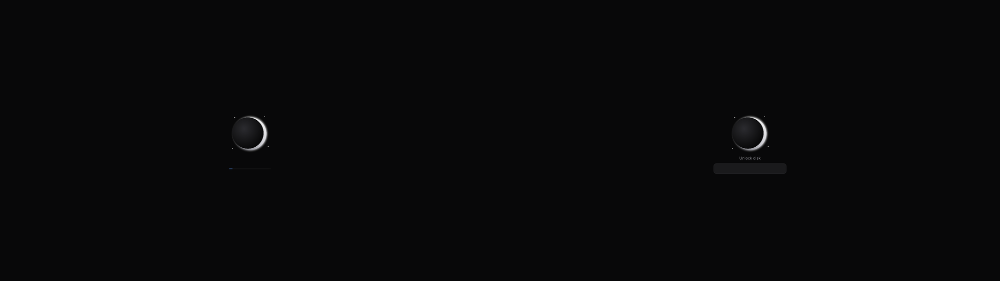

# Nyx Plymouth

The NyxOS boot splash: the theme's background, the Nyx eclipse fading in at the
centre, a thin progress line under it, and a quiet password field when the disk needs
unlocking. No other text, no elaborate animation.



There's one Plymouth theme per built-in Nyx theme, built with the Nyx theme engine
(the `nyx-theme` command from nyx-design): its resolved colours, and the system logo
in its logo colour. The logo is the Nyx mark unless `--logo` names another (an SVG
drawn in `currentColor` takes each theme's colour; a PNG is used as it is).

```sh
tools/generate.py --nyx-theme ../nyx-design/target/debug/nyx-theme   # → build/themes/<theme>/
tools/generate.py --logo my-logo.svg                                 # with another logo
tools/preview.sh nyx-dark 1920x1080                                  # → build/preview/nyx-dark-*.png
```

`preview.sh` needs Xvfb and bubblewrap and runs without root: Plymouth runs as root of
its own user namespace, draws into an invisible display, and sees the built themes
mounted over `/usr/share/plymouth/themes` for that run only.

## NyxOS

[nix/nyx-plymouth.nix](nix/nyx-plymouth.nix) is the recipe for nyx-packages: it runs
the generator with the `nyx-theme` package (and the system logo, `logo`, when one is
set) and installs `build/themes/*`. The system then sets
`boot.plymouth = { enable = true; themePackages = [ nyx-plymouth ]; theme = "catppuccin-mocha"; }`.
The boot theme is a system setting and can differ from the desktop theme.

## Files

- `src/nyx.script`: the Plymouth script, with `@BG@` and `@DIM@` filled in per theme.
- `tools/generate.py`: builds the themes.
- `tools/preview.sh`: screenshots the fade-in, the boot, the password prompt and a
  message.
